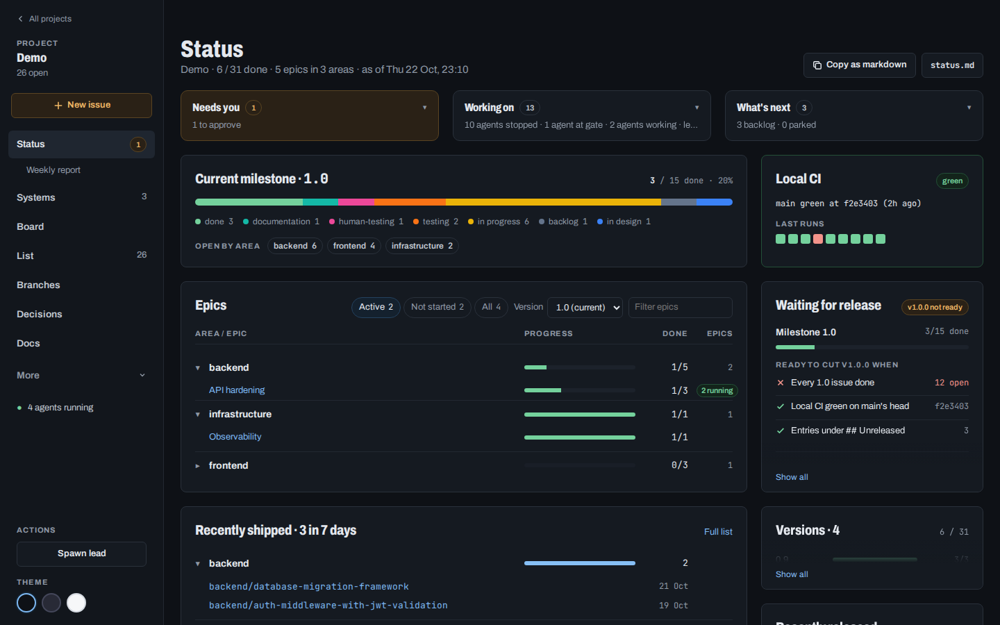
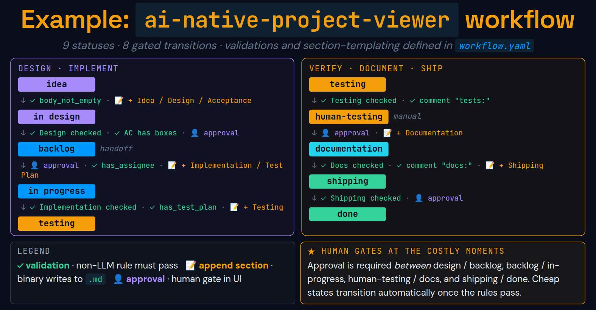
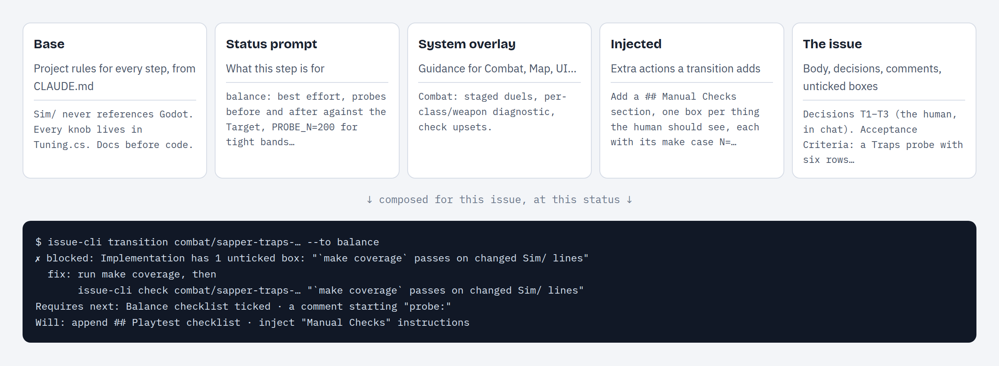
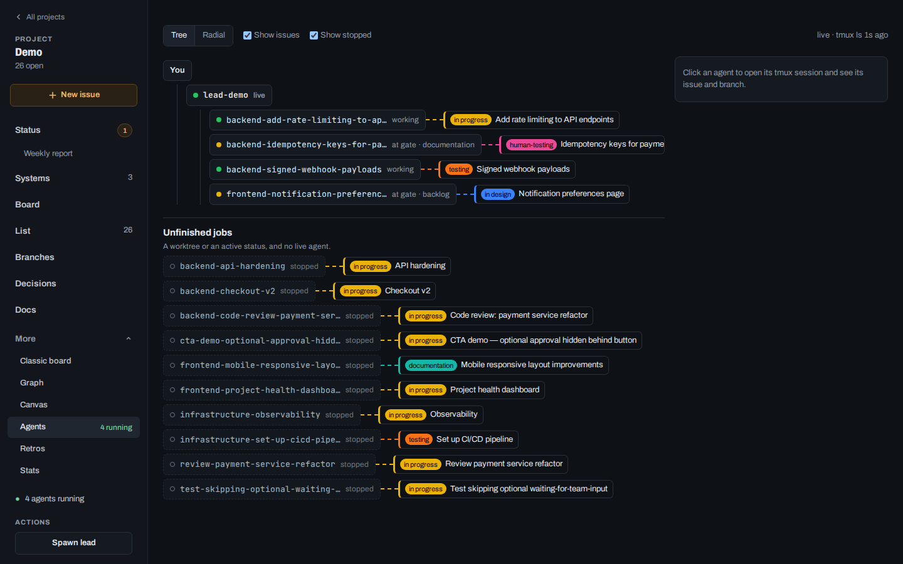
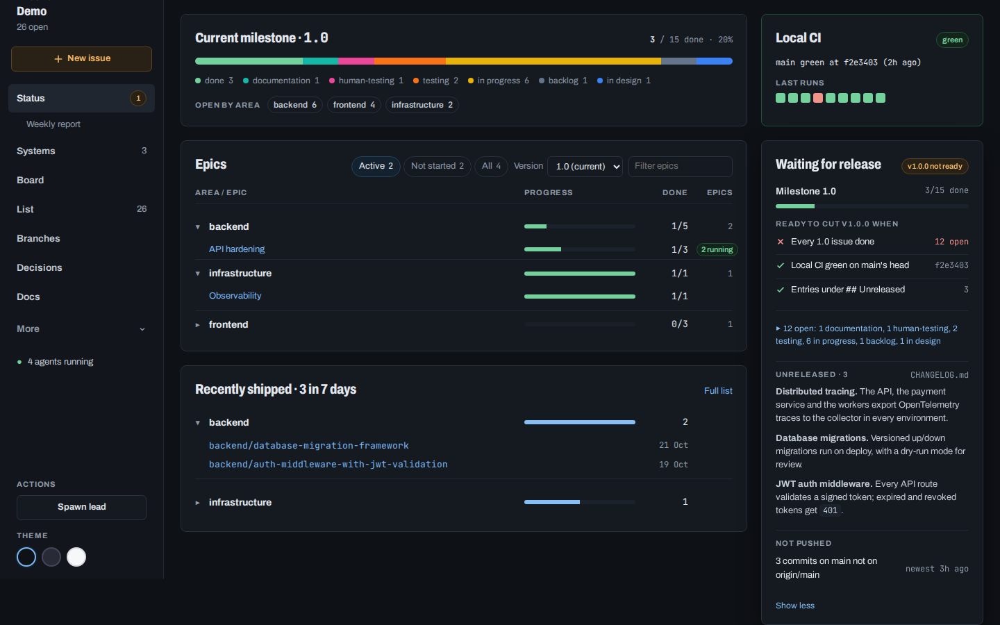
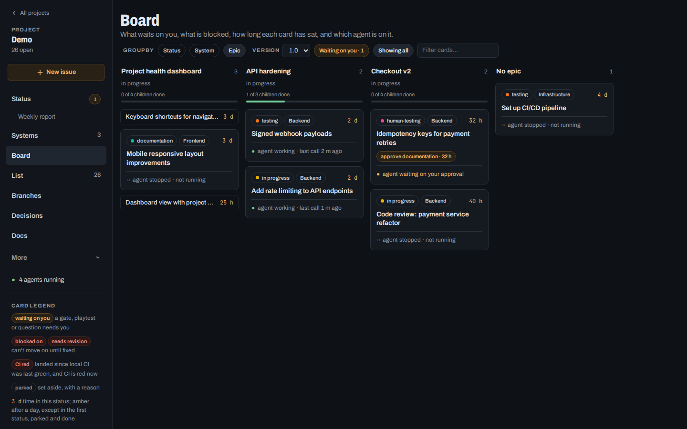
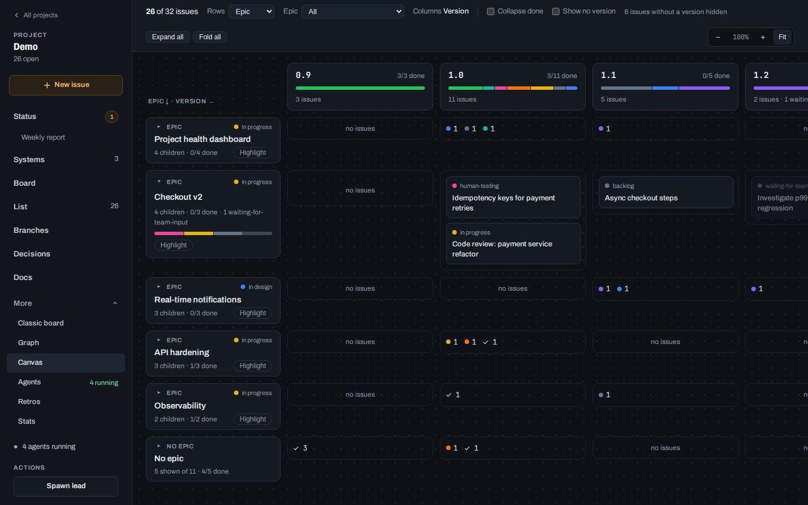
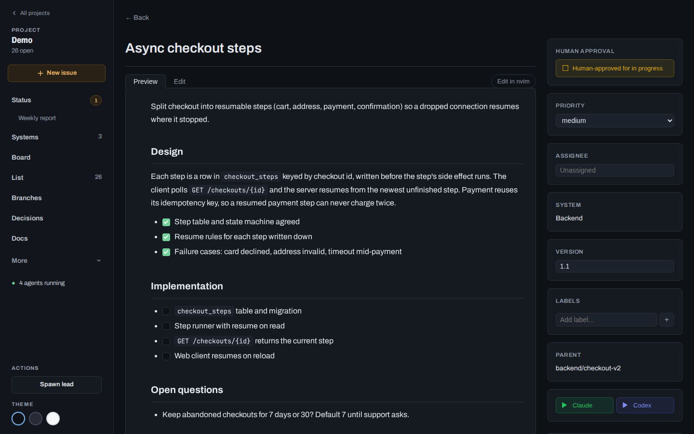
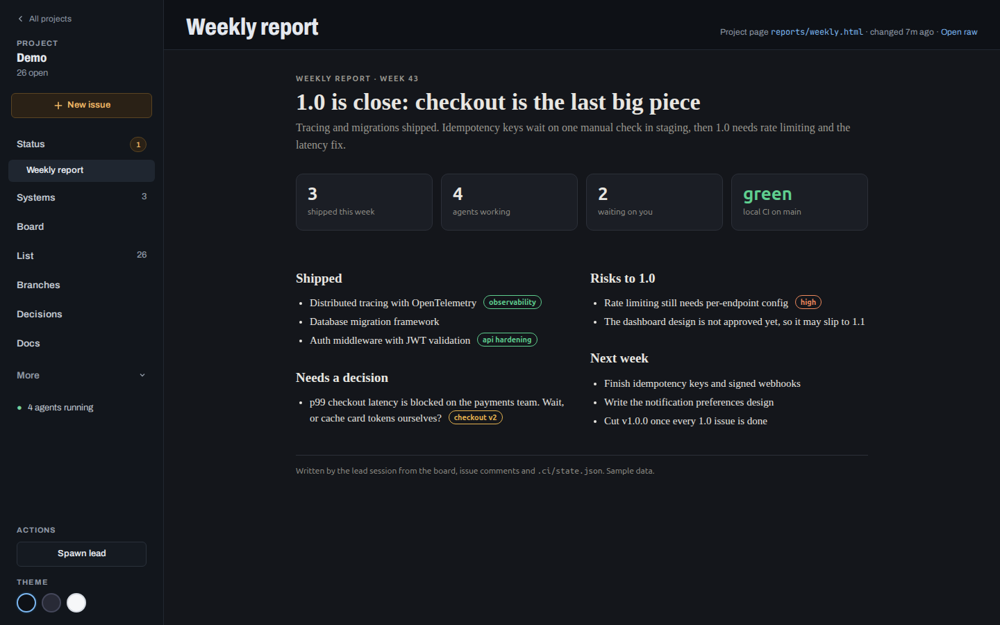

# AI Workflow Engine

**Run AI coding agents through a process you define, and approve the moments that matter.**

Issues are markdown files in your repo. The process is one `workflow.yaml`. Claude Code or Codex agents walk each issue through it with `issue-cli`, which won't let them skip a step, and you watch, steer and approve from a local web board.

Built for developers who already run Claude Code or Codex on their own repositories. Bundled templates also cover review queues and long-form writing.

<!-- Hero GIF slot (docs/images/hero.gif, not recorded yet): open an issue, press ▶ Claude; the agent's tmux pane runs `issue-cli start`; it blocks on a human approval; tick it on the issue page; the agent carries on and the card moves. 20–30 s, 1280×720, under 5 MB. Until then the Status screenshot is the hero. -->


The **Status page** is where you start: what waits on you, what every agent is doing, how the current milestone stands, and whether `main` is green and ready to release.

[Quickstart](#quickstart) · [How it works](#how-it-works) · [An issue's life](#an-issues-life) · [Screenshots](#screenshots) · [Configuration](#configuration) · [Commands](#commands) · [What's new](#whats-new) · [Docs](docs/)

## Why

Coding agents are good at writing code and bad at knowing when to stop. Left alone they skip the design, call untested work done, and ask you at the wrong moment or not at all.

AI Workflow Engine puts a contract around them:

- **One step at a time.** An agent moves an issue forward only when that step's checks pass: a section written, its checkboxes ticked, a `tests:` comment posted, a shell command green.
- **You own the costly moments.** Gates such as `backlog → in progress` wait for your tick on the board. The agent asks in chat and ends its turn; your approval nudges it to carry on.
- **Guidance arrives just in time.** Each status has its own prompt, and every failed check prints the command that fixes it. There is no giant system prompt to drift from.
- **Everything is files.** Markdown issues, a YAML workflow, git history as the audit log. No database, no SaaS, no API keys. The same workflow runs with Claude Code and Codex.

The longer argument, vendor harness vs. workflow harness: [docs/why.md](docs/why.md).

## Quickstart

You need Linux or macOS. To dispatch agents you also need `tmux`, `git`, and the `claude` or `codex` CLI on your `PATH`.

```bash
# 1. Install issue-viewer (the board) and issue-cli (the agent CLI) into ~/.local/bin
curl -fsSL https://raw.githubusercontent.com/michal-franc/ai-workflow-engine/main/install.sh | bash

# 2. In your repo: write workflow.yaml and create issues/ and docs/
cd my-project
issue-cli init --template development     # or: review, writing

# 3. Capture a first issue
issue-cli create --title "Add a dark mode toggle" --system UI
```

Tell the board where things live with a `projects.yaml` in the same folder:

```yaml
projects:
  - name: "My Project"
    slug: "my-project"
    issues: "./issues"
    docs: "./docs"
    workdir: "."
    terminal: "none"   # print the tmux attach command instead of opening a window
```

```bash
# 4. Open the board on http://localhost:8080 (it listens on 127.0.0.1 only)
issue-viewer -config projects.yaml
```

Open the issue and press ▶ **Claude** (or **Codex**). The agent starts in a tmux session (`tmux attach -t agent-<slug>`), reads the workflow with `issue-cli process`, works the issue, and stops at the first gate for you.

Just looking? Clone the repo and run `make demo` (Go 1.25+) to open a sample project. Other install options (a pinned version, manual download, building from source) are in [docs/getting-started.md](docs/getting-started.md).

## How it works



| Piece | What it is |
|---|---|
| **Issues** | One markdown file per issue, `issues/<System>/<slug>.md`. Frontmatter holds `title`, `status`, `system`, `version`, `priority`, `labels`, `assignee` and any custom key. The body grows section by section; comments sit in a hidden block at the end of the file. See [docs/issue-format.md](docs/issue-format.md). |
| **Workflow** | `workflow.yaml`: statuses with a prompt each, transitions with ordered actions (`validate`, `require_human_approval`, `append_section`, `inject_prompt`, `set_fields`), optional side states, and per-system overlays. |
| **issue-cli** | How agents (and you) move issues: `start`, `check`, `comment`, `transition`. It enforces the workflow and prints `Requires:` / `Will:` before every step. |
| **The viewer** | `issue-viewer`: the Status page, a board whose cards carry what waits on you, the issues canvas (epics × versions), the agents canvas, list and docs, the issue page with its approval boxes, retros and stats, and your project's own HTML pages. One server hosts many projects and listens on localhost only. |
| **The lead** | One Claude or Codex session per project (`lead-<project>`) that you talk to. It dispatches workers, relays their questions, ticks the gates you approved in its chat, and cuts releases. |
| **Workers** | ▶ on an issue starts Claude or Codex in tmux (`agent-<slug>`) with a briefing built from the workflow. With `worktree: true` each issue gets its own git worktree and branch. |

### Gates and checks

Each transition says what must be true before the move and what happens after it:

```yaml
transitions:
  - from: "backlog"
    to: "in progress"
    actions:
      - type: require_human_approval     # waits for your tick on the board
        status: "in progress"
      - type: append_section             # the next step starts from a checklist
        title: "Implementation"
        body: |
          - [ ] Happy path
          - [ ] Edge cases
  - from: "testing"
    to: "human-testing"
    actions:
      - type: validate
        rule: section_checkboxes_checked
        section: "Testing"
      - type: validate
        rule: "has_comment_prefix: tests:"
```

Checks include `body_not_empty`, `has_section`, `section_min_length`, `section_checkboxes_checked`, `has_comment_prefix`, `field_in`, `has_label`, `has_pr_url`, `linked_issue_in_status`, `no_todo_markers` and `command_succeeds` (runs a shell command; opt in with `allow_shell: true`). `issue-cli process schema` prints them all. Full reference: [docs/workflow.md](docs/workflow.md).

At each step the agent gets a small, current prompt rather than one big manual, and a failed check tells it exactly what to do next. Here is one step on a real project:



### The lead and its workers

You talk to one session, the project lead. Start it with `issue-cli lead spawn` or **Spawn lead** in the sidebar. It grooms ideas with you, dispatches workers, checks on them, relays their questions one at a time, and ticks a gate only after you approved it in its chat (`issue-cli approve`, which records your words). Workers each own one issue in their own worktree and never tick a gate. There is one lead per project, and it leads the epics too.


How to set it up, and how the lead routes, hands off and leads epics: [docs/patterns/lead-session.md](docs/patterns/lead-session.md). The agents canvas shows the lead, its live workers and the jobs left unfinished:



### Shipping: local merge, local CI, a release per milestone

How an issue ships is up to your workflow's `shipping` step. The bundled `development` template commits and pushes. This repository ships differently, and the viewer supports it:

- **Agents never push.** A worker merges `main` into its branch, runs `make validate`, and fast-forwards the local main checkout. Local `main` is the integration branch.
- **Local CI** re-tests `main` after every merge. An opt-in `ci:` block in `workflow.yaml` names the commands. The viewer watches the branch, runs them in tmux `ci-<project>` and records each run under `.ci/`. A red run reaches the Status page, card markers, `ci:` comments on the issues that landed and the lead. See [docs/workflow.md#local-ci](docs/workflow.md#local-ci).
- **A release per milestone.** Issues carry a `version:`. Agents add their change under `## Unreleased` in the changelog. The Status page's **Waiting for release** card lists those entries and the commits not pushed, and says whether the milestone is ready to cut: every issue done, CI green on the head, entries under `## Unreleased`. The lead then renames the heading, and pushes when you give the go-ahead.



### Agents on the board

- **Dispatch** from the issue page (▶), or let the lead do it. Each agent gets a tmux session `agent-<slug>`, or a window in one shared session when the project sets `tmux_session`. With `terminal: none` and `tmux_session_per_project: true` in `projects.yaml`, every project's lead and workers are windows of one session, and nothing opens a terminal.
- **Worktrees.** With `worktree: true` the agent works in `.worktrees/<slug>` on branch `work/<slug>`. `issues/` is left out of the worktree, so issues stay on your main checkout; `worktree_setup: "make"` bootstraps a fresh one.
- **Approvals.** When a step needs you, the CLI error links straight to the box (`…/issue/<slug>#approve-in-progress`). The agent asks in chat and ends its turn, and your tick nudges its tmux session to resume.
- **The trail.** Every `issue-cli` call is logged under `.agent-logs/` and shown as a timeline on the issue page, next to the exact prompt the agent was given.
- **Retros and bug reports.** Agents leave `issue-cli retrospective` notes, which the Retros page collects, so you can fix the process where it hurt. `issue-cli report-bug` files bugs in the tool itself as `cli-bug` issues on this project's board, from any project.
- **Custom buttons.** `issue_actions` and `project_actions` in `workflow.yaml` add one-click agent jobs (a review, a report, a sweep) to the issue page or the board.
- **Manual checks as playtests.** An issue's manual checks are a YAML session whose step ids are the issue's checkbox ids. A machine runs everything it can see in headless Chrome against a throwaway board; you judge the rest in an overlay, and a report ticks the boxes that passed. See [docs/patterns/playtest/](docs/patterns/playtest/README.md) or `issue-cli process playtest`.

Terminals, shared sessions, models and worktrees: [docs/agent-dispatch.md](docs/agent-dispatch.md). The full dispatch-to-done path: [docs/agent-workflow-flow.md](docs/agent-workflow-flow.md).

## An issue's life

One issue through the `development` template, abridged:

```text
you    issue-cli create --title "Rate-limit the login endpoint" --system API
agent  issue-cli start <slug>                            claims it, prints the checklist and the next step
agent  issue-cli transition <slug> --to "in design"      body_not_empty passes; Design section appended
agent  … writes the design, ticks its boxes: issue-cli check <slug> D1 D2 D3
agent  issue-cli transition <slug> --to "backlog"
       approval for "backlog" is missing: asks you in chat, ends its turn
you    tick the approval on the issue page                       ← gate 1: the design
agent  nudged by the tick: moves to backlog, issue-cli start <slug>, asks for the go-ahead, ends its turn
you    tick the next approval                                    ← gate 2: start building
agent  builds, tests, posts "tests: go test ./... green", moves to testing, then human-testing
you    judge the steps a machine can't (make playtest), tick the approval  ← gate 3: it works
agent  documentation → shipping
you    tick the last approval                                    ← gate 4: ship it
agent  → done, then files a retrospective on the workflow
```

The same rhythm on a real issue, replayed from its logs: Raid League's "Sapper traps" went from discussion to pushed in 3 h 50 m, with the human in the loop at four ticks and a few chat answers.


## Screenshots

All taken from the sample project (`make demo`).

**The board.** Cards carry what waits on you, how long they have sat and which agent is on them. Here they are grouped by epic for milestone 1.0.



**The issues canvas.** One row per epic and one column per version. Epics start folded to a count per status; open one to see its cards, or pick a single epic with the Epic filter.



**An issue.** The body grows section by section. Approvals and dispatch sit in the sidebar.



**Project pages.** A project (or its lead) writes its own HTML, such as a weekly report, and the viewer shows it in its frame. It runs sandboxed, with live counts over `postMessage` ([docs/workbench-files.md](docs/workbench-files.md#project-pages-status_page-pages)).



## Configuration

**`projects.yaml`** tells the board about your projects (one server, many projects):

| Key | Purpose |
|---|---|
| `name`, `slug` | Display name and URL slug (`/p/<slug>/`) |
| `issues`, `docs`, `workflow`, `workdir` | Where the files live; `workdir` is where agents start |
| `terminal` | Command that opens a window on the agent's session, with `{{session}}` substituted; `none` for headless. Unset means i3 + alacritty |
| `tmux_session` | Run every agent of the project as a window in one shared session |
| `tmux_session_per_project` | Top level: give each project one session for its lead and workers (with `terminal: none`, nothing opens a window) |
| `agent_model_source`, `agent_models` | `project` pins a model per agent (`claude`, `codex`); `global` (default) leaves it to the agent |
| `repo`, `supports_github`, `import_status` | GitHub sync and auto-close ([docs/github-integration.md](docs/github-integration.md)) |
| `telemetry` | `false` turns off issue-cli's local, names-only usage log ([docs/CLI/telemetry.md](docs/CLI/telemetry.md)) |

**`workflow.yaml`** is the process: `statuses`, `transitions`, `systems` (per-system overlays), `board` (columns and card fields), `scoring`, `worktree`, `worktree_setup`, `worktree_sparse_exclude`, `allow_shell`, `issue_actions`, `project_actions`, `leads` (the lead's brief), `ci` (local CI) and `workbench` (changelog, project pages, metric files). Start from a template with `issue-cli init`, edit it as text (`issue-cli workflow upgrade` pulls in template changes), or print the schema with `issue-cli process schema`. See [docs/workflow.md](docs/workflow.md) and [docs/board-configuration.md](docs/board-configuration.md).

## Commands

| | |
|---|---|
| `issue-cli process` | Learn the project's workflow (agents run this first) |
| `issue-cli next` | Find the next issue to work on |
| `issue-cli start <slug>` | Claim an issue and get its checklist and next step |
| `issue-cli transition <slug> --to <status>` | Move one step (`--dry-run` lists what's missing) |
| `issue-cli check <slug> D1 D2` | Tick checkboxes by id |
| `issue-cli comment <slug> --text "…"` | Add a comment (`tests:`, `docs:`, `progress:` …) |
| `issue-cli context <slug>` | Everything about one issue |
| `issue-cli list`, `search`, `stats` | Find and summarise issues |
| `issue-cli retrospective <slug>`, `report-bug` | Feedback on the workflow and the tool |
| `issue-cli lead spawn`, `approve <slug>` | Start the project lead; the lead records an approval you gave in chat |
| `issue-cli ci status` | Local CI: where `main` stands and the recent runs |
| `issue-viewer -config projects.yaml [-port 8080]` | Start the viewer (localhost only; `-host` to change it) |

All commands: `issue-cli help`, or [docs/CLI/overview.md](docs/CLI/overview.md).

## In real use: Raid League

Raid League is a football-manager-style game about a fantasy siege tourney, built in Godot and C# by one person and a crew of Claude agents on this engine since September 2026:

- **235 issues** on the board and a **710-line workflow** with its own statuses, four human gates and 13 system overlays.
- **Board buttons** for recurring agent jobs: *Balance report*, *Speed sweep*, *Idea sweep*.


Raid League runs with one project lead and a handful of workers at a time, the setup described in [The lead and its workers](#the-lead-and-its-workers).

## What's new

- **v0.53, Safe core:** local CI on the integrated `main`, a Status page rebuilt for hundreds of issues (Needs you, Working on and What's next tiles, epics by area, Waiting for release), the viewer bound to localhost with cross-origin writes refused, and graceful shutdown.
- **v0.52, project status pages:** your own HTML pages in the viewer, sandboxed, and one lead per project that leads the epics too.
- **v0.51, one terminal:** every project's lead and workers as windows of one tmux session.
- **v0.49:** the new Board, with markers, an agent footer and grouping by status, system or epic.

Every change is in [cmd/issue-cli/CHANGELOG.md](cmd/issue-cli/CHANGELOG.md) and `issue-cli process changes`.

## Status and roadmap

Version 0.53 (October 2026). Pre-1.0 and moving fast. Each version is one milestone with one focus, released when its last issue ships. Renamed keys keep a deprecated alias (`actions:` still works next to `issue_actions:`).

Next, from [docs/roadmap.md](docs/roadmap.md):

- **0.54, project health:** the engine measures size, speed and agent cost, and tells you when they get worse
- **0.55, a fast, robust server** on big projects
- **0.56, setup in minutes:** from install to a working board without hand-editing config
- **0.57, gates you can trust:** every check measures what it says
- **0.58, one landing page:** Status at `/`; the Classic board and Graph are retired

## Contributing

The author tracks this tool's own work with the tool (its `issues/` folder is kept out of git). Before sending a change, run `make validate` (go vet, the test suite and a coverage floor on `issue-cli`). Build with `make build` and `make build-cli`; `make demo` starts the board on the sample project.

## Licence

[FSL-1.1-MIT](LICENSE.md): free to use, modify and contribute; no competing product or service; each release becomes MIT two years after it ships. See [LICENSE.md](LICENSE.md).
