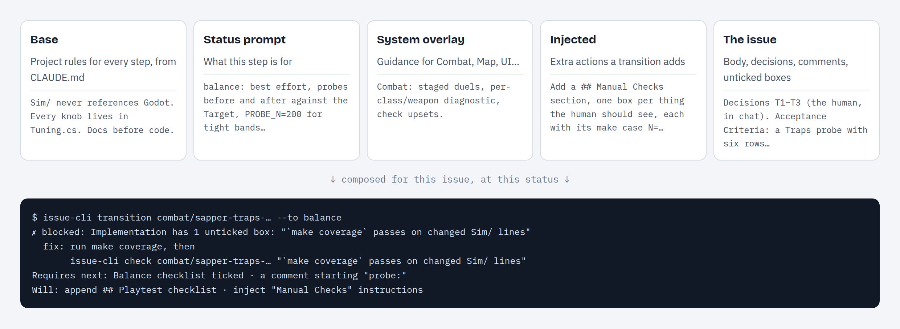

Three parts of the harness keep an agent focused through a long session: just-in-time prompts, checkboxes and gates. This page explains how they work together and why they help with the "lost in the middle" problem.

## The problem: lost in the middle

Models use the start and the end of their context best and the middle worst ([Liu et al., *Lost in the Middle*, 2023](https://arxiv.org/abs/2307.03172)). An agent session makes this worse every turn:

- A rule given once at dispatch moves toward the middle as diffs, test logs and tool output pile up after it.
- A long upfront prompt lists every step of the lifecycle, so the guidance for the current step is buried among the others.
- Nothing outside the context remembers what was asked, so a step the agent forgot looks the same as a step it finished. The agent declares "done".

The harness doesn't try to make the agent remember more. It keeps what matters out of the context until it's needed, writes it to disk, and checks it in code.

## Three mechanisms

| Mechanism | What it does | The failure it covers |
|:--|:--|:--|
| **Just-in-time prompts** | Gives the guidance for the current step only, as the output of the command the agent just ran | Guidance drifting into the middle; guidance for other steps getting in the way |
| **Checkboxes** | Keeps each requirement as a box in the issue file, added when its step starts | Requirements living only in the context, where they get lost |
| **Gates** | Validators that block a transition and print the open items and the command that fixes them | The agent forgetting something and moving on anyway |

### 1. Just-in-time prompts: the newest tokens

The agent doesn't get one big prompt up front. `issue-cli start` and `transition` put one together for the current step:

- **Base**: project rules (CLAUDE.md), kept short.
- **Status prompt**: `statuses[].prompt`, what this step is for.
- **System overlay**: extra guidance for the issue's `system` (API, CLI, UI…).
- **Injected**: an `inject_prompt` on the transition just taken, shown for that one move.
- **The issue**: body, decisions, comments and open boxes, read fresh from disk.



Why this helps attention:

- **It shows up at the end.** The guidance is the output of the call the agent just made, so it's the newest thing in the context, where recall is strongest.
- **It's small.** Only the current status's guidance is shown, not all nine statuses, so nothing competes with it.
- **It comes back.** `start` is safe to re-run and prints it again, so after a long stretch of work the guidance goes back to the end of the context.
- **The action comes last.** `start` and `transition` print the checklist, then the guidance, then `== Next ==` (the command, `Requires:` and `Will:`). The thing to do next is the last thing the agent reads.

### 2. Checkboxes: memory outside the context

Requirements are written into the issue file as boxes, not kept in the conversation:

```yaml
- from: "in progress"
  to: "testing"
  actions:
    - type: "append_section"
      title: "Testing"
      body: |
        - [ ] Relevant tests for changed code passing
        - [ ] Test results logged as comment (`issue-cli comment <slug> --text "tests: ..."`)
```

- **They arrive on time.** `append_section` adds a section on the transition into its step, so the `## Testing` boxes appear when testing starts, not at dispatch.
- **They live on disk.** A box is in the file whether or not the agent still remembers it, and it survives compaction, restarts and a new session picking the issue up.
- **They're cheap to point at.** Every box has a stable id (`D3`, `AC1`, `T2`). `issue-cli check <slug> T1 T2` ticks several at once, and every list ends with the exact command to tick them.
- **Progress is printed after each step.** `check` prints `Progress: 3/11 (Testing 2/4)` after each tick. `start`, `show` and `transition` print the whole checklist. Each one brings the open work back to the end of the context.

A box turns a vague instruction ("make sure tests are logged") into a specific item you can see and count.

### 3. Gates: checks that don't depend on attention

A gate is a `validate` action on a transition. It runs in code, so it works the same whether the agent remembers the rule or not:

```
Error: failed to transition: 2 of 4 boxes still open in section "Testing":
  T2   Known unrelated failures documented if full suite is red
  T3   Test results logged as comment (`issue-cli comment <slug> --text "tests: ..."`)

Tick the ones that are done (ids, several at once):
  issue-cli check <slug> T2 T3
```

- **It brings a lost rule back.** A requirement that slipped into the middle comes back as the newest output, at the moment the agent tries to move on.
- **It names the fix.** Every failure is `<problem> — <hint>`, with an `issue-cli` command the agent can run. The agent doesn't have to remember the procedure.
- **It shows everything at once.** `transition --dry-run` lists every unmet requirement in one call (`validator`, `field`, `approval`, `order`), so the agent doesn't find them one failure at a time.
- **It hands off to a person.** `require_human_approval` stops the agent. It tells the human what to approve, ends its turn, and the approval message wakes it again. An agent can't approve itself.

## The loop

```
start ─► guidance + open boxes (end of context)
  │
  ▼
work ─► check <ids> ─► progress line (end of context)
  │
  ▼
transition ─► gate passes ─► next step's boxes + guidance appended ─► work …
         └──► gate fails  ─► open ids + fix command (end of context) ─► work …
```

Every turn of the loop ends with the CLI printing what is still open. The agent never has to recall an instruction from 50k tokens back: the harness prints it again when it matters.

## Writing workflows that use this

- **Put must-dos in boxes, not prose.** A sentence in a status prompt can be forgotten. A box under a gated section can't be skipped.
- **Gate every section you append.** `section_checkboxes_checked: <Title>` on the way out. `section_has_checkboxes` only checks that boxes exist; use it when the boxes are ticked at a later step.
- **Keep status prompts short and about one step.** They're shown on every `start`. Long ones push the checklist and `Next` up out of view.
- **Use `inject_prompt` for one-move advice.** It's shown on that transition only and doesn't repeat for the rest of the step.
- **Write a `hint:` with the exact command.** A fix the agent can paste is better than one it has to work out.
- **Prefer CLI output and errors over prompt text.** The agent sees an error at the moment it acts. It might not see a prompt line at all.

## Limits

A gate checks that a box is ticked, not that the work is true. Back the boxes that matter with evidence the engine can check:

- `has_comment_prefix: tests:` requires a logged test result.
- `command_succeeds` runs a real check (`allow_shell: true`).
- Playtest sessions (`make ux-test`) cover UI steps.
- `require_human_approval` covers the decisions that need a person.

## See also

- [Why a Workflow Harness](../why.md): the argument behind the tool
- [Workflow](../workflow.md): prompts, side-effects and every validator
- [Gate sections](../Workflow/overview.md#gate-sections-append_section): how `append_section` creates or tops up a section
- [CLI `check`](../CLI/overview.md#check) and [`transition`](../CLI/overview.md#transition): ids, dry runs, gate failure output
