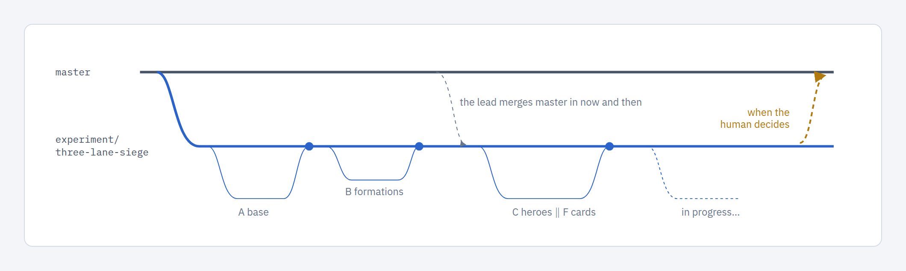

A way to run several agents on one project without the human talking to each of them. The tool knows about **lead agents**: it spawns them, names them, routes workers to them and shows them on the agents canvas. Raid League, a game built this way, is the worked example at the end.

## The roles

| Role | tmux name | Runs in | Does |
|---|---|---|---|
| **The human** | (you) | | Decides. Raises ideas, answers questions, approves gates, playtests. |
| **Project lead** | `lead-<project>` | the project checkout | Runs the project with you: grooms ideas, gets workers dispatched, checks on them, relays their questions, reviews designs and diffs, ticks the gates you approved in its chat, fixes the process from the retros. One per project. |
| **Sub-lead** | `lead-<epic-slug>` | `.worktrees/<epic-slug>`, on the epic's base branch | Stabilises one epic: gets workers onto its children, reviews and merges their work into the base branch, keeps that branch green and up to date with `main`, runs the joint checks, and takes it to `main` when you decide. At most one per epic. |
| **Workers** | `agent-<slug>` | `.worktrees/<slug>` | Own one issue each. Walk it step by step, leave a trail of comments, stop at every human gate. Never tick a gate. |

```
human
  └─ project lead            lead-<project>      project checkout
       ├─ sub-lead           lead-<epic-slug>    worktree on the epic's base branch
       │    ├─ worker        agent-<child-slug>  child worktree, branched from base
       │    └─ worker
       └─ worker             agent-<slug>        issues with no epic
```

The depth is fixed: a sub-lead can't spawn sub-leads. You talk to the project lead; it relays to the sub-leads, and the leads talk to the workers. You can still attach to any session's tmux. The board stays the source of truth for status and approvals.


The name is the identity, the same rule as `agent-<slug>` for workers. Slashes, dots and spaces in an epic slug become `-` (`ui/workbench` → `lead-ui-workbench`). Lead sessions also export `ISSUE_VIEWER_LEAD_SCOPE` (`project` or the epic slug), so `issue-cli lead whoami` and the refusals below know who is asking.

## Spawning leads

| Lead | CLI | UI |
|---|---|---|
| Project lead | `issue-cli lead spawn` | **Spawn lead** in the sidebar's Actions, or on the [agents canvas](../UI/overview.md) |
| Sub-lead | `issue-cli lead spawn --epic <slug>` | none. One lead per project for now (workbench umbrella D-13), so the UI has no sub-lead button |

The CLI and the buttons start the same session; the CLI doesn't need the viewer running.

- `lead spawn` starts `lead-<project>` in the project checkout, or a `lead-<project>` window in the shared session when `tmux_session` is set. It runs headless unless you pass `--attach`, which opens a terminal with the same `terminal`/`i3_workspace` settings as dispatch. `--agent codex` runs Codex instead of Claude.
- A lead that is already live is re-attached and its name printed. A second lead is never started.
- `lead spawn --epic <slug>`:
  1. picks the base branch: the epic's `base:`, otherwise `base/<epic-slug>`, created from `main` when it doesn't exist;
  2. creates `.worktrees/<epic-slug>` on that branch, with the same sparse excludes and `worktree_setup` as worker worktrees;
  3. records `base:` and `lead: lead-<epic-slug>` on the epic;
  4. starts `lead-<epic-slug>` there.
- Dispatching the epic issue itself reuses that worktree; the epic gets no `work/<slug>` branch of its own.
- Refusals name who can do it instead:
  - from a worker: "post a `question:`; your lead is lead-x";
  - from a sub-lead: the fixed depth, ask the project lead;
  - `--epic` on an issue that is not an epic.

### What is an epic

An epic is an issue that other issues name as their parent, or that has `type: epic`, `lead:` or `base:`. A child links to it with `parent: <epic-slug>`. The older `umbrella: <slug>` is read as an alias; `show` and `start` print a hint to rename it:

```bash
issue-cli set-meta <child-slug> --key parent --value <epic-slug>
```

### Briefs

Each lead starts with a brief from the `leads:` block of `workflow.yaml`. A workflow without it gets built-in defaults, so every project has leads without editing anything.

```yaml
leads:
  project: |
    You are the project lead of {{project}}. You run in {{lead}}. ...
  epic: |
    You are the sub-lead of epic {{epic}} ("{{title}}"). Base branch {{base}};
    you report to {{project_lead}}. ...
```

Placeholders: `{{project}}`, `{{lead}}`, `{{project_lead}}`, `{{epic}}`, `{{title}}`, `{{base}}`. `issue-cli` commands in the brief get `--project` injected, as in dispatch prompts. The CLI appends a fixed footer to every brief: the lead's role, who it reports to, what it may tick, its handoff note, and `issue-cli lead whoami`.

## Routing: who is my lead

"My lead" is derived from the parent link and the live tmux sessions. It is never stored.

- A worker on a child of an epic reports to the epic's sub-lead while `lead-<epic>` is live, and otherwise to the project lead.
- Any other worker reports to the project lead.
- A sub-lead reports to the project lead.

The worker's dispatch prompt names its lead under `## Your lead`. A child of an epic with a base branch also gets `## Base branch`: build on the base, merge the base (never `main`) to pick up a sibling's work, and target the base when shipping. `issue-cli show` and `start` print the issue's lead, for example `Lead: lead-<epic> (live, sub-lead of epic <epic>)` or `Lead: lead-<project> (live; epic <epic> has no live sub-lead)`.

## Seeing and reaching leads

| Command | Shows or does |
|---|---|
| `issue-cli lead whoami` | Your role (project lead, sub-lead, worker or unmanaged), scope, the branch you guard, your lead and whether it is live, how to reach it, and what you may tick |
| `issue-cli lead list` | One row per lead: scope, session, live or not, base branch, commits on `main` not yet in the base, children running of total. Also the epics with no sub-lead |
| `issue-cli lead message <target> "text"` | Pastes the text into a session, signed `[from lead-x]`. Target: `project`, a `lead-`/`agent-` name, an epic slug (its sub-lead) or an issue slug (its worker) |
| `/p/<project>/agents` | The agents canvas: the whole tree, each agent's state and the unfinished jobs. Click an agent to open its tmux session; its panel has Approve gate, Spawn and Copy attach |

Agents can also message each other with Claude Code's built-in messaging between sessions (`ListAgents` / `SendMessage`): Claude agents are launched with `-n <tmux name>`, so `lead-<project>`, `lead-<epic>` and `agent-<slug>` are their addresses, and the briefs tell workers they may message their lead or a peer this way. Nothing in the tool gates or records these messages. `lead message` is the tmux-paste fallback (for Codex), and workers can't use it; they post `question:` comments, which their lead reads from the issue trail. A lead still reads everything without interrupting anyone:

| Channel | Command | Shows |
|---|---|---|
| Issue | `issue-cli context <slug>` | Status, checklists, comments |
| Branch | `git worktree list`, `git log --oneline <base or main>..<branch>` | Code written so far, overlaps between branches |
| Logs | `.agent-logs/<session>/` | Every `issue-cli` call, the full transcript |
| Screen | `tmux capture-pane -p -t <session> \| tail -40` | What the agent is doing or waiting on |

A lead started by hand (plain `claude` in the project root) still works, but the tool can't see it: `lead whoami` reports it as unmanaged and tells it to run `issue-cli lead spawn`.

## Authority: who may tick a gate

Approvals are the `human_approval` field in the issue's frontmatter. The human sets it with the board's checkbox. A lead records an approval you gave in chat with:

```bash
issue-cli approve <slug> --to <status> --quote "<the human's words>" [--how "relayed by lead-<project>"]
```

It writes an `approval:` comment with your words, then sets `human_approval`. It never toggles an existing approval off.

| Who | May tick |
|---|---|
| Project lead | Any gate you approved in its chat. |
| Sub-lead | Only its epic and the epic's children, and only for words the project lead relayed (`--how` defaults to `relayed by lead-<project>`). |
| Worker | Never. |
| Any agent | Never Human Testing; you approve that in the viewer. |

These checks read the environment and the session name. They are guardrails for agents, not security.

## Running it

### Check-ins and stand-ups

While workers run, the lead checks in on a schedule (Raid League uses :07, :27 and :47 past the hour) and reports only what changed: questions waiting, a gate reached, red tests, an idle agent, two branches touching the same files. On request it gives a **stand-up**: one line per dispatched issue with status, last progress and blockers, then the approvals waiting for you.

### Relaying questions

Workers that need a decision write it with `issue-cli ask` (options and a recommendation, stored under `## Questions` in the issue), say they're waiting, and stop. A sub-lead sends its own questions and its workers' to the project lead with `lead message project "..."`. The project lead brings them to you **one at a time**, with the worker's recommendation and its own. It records your answer in your words with `issue-cli answer <slug> Q-n --option B --note "…"`, which writes the `D-n` line under `## Decisions` and closes the question, then messages the asker.

### Worker rules

The dispatch prompt and the status prompts in `workflow.yaml` already tell workers these, but a short doc your `CLAUDE.md` points to helps sessions that weren't dispatched:

- Own your issue only. New ideas become `idea` issues (`issue-cli create`), referenced with `#slug`.
- Stop at human gates. Ask once in chat, then stop and end your turn; don't wait or poll. Continue when the human messages you that it is approved. A "go" in your chat is not an approval.
- Leave a trail: tick boxes as they're done, add `progress:` comments at milestones, and the comments your gates require (`tests:`, `docs:`, …).
- Commit on your own branch as you go; only shipping merges.
- Write a retrospective when you stop (`issue-cli retrospective`).

### Before dispatching

- Commit process changes (`CLAUDE.md`, `workflow.yaml`) first: worktrees branch from the checkout's `HEAD` (or the epic's base), so workers read whatever is committed there.
- Don't dispatch onto a pending gate. If `issue-cli checklist <slug>` shows the issue only waits for your approval, ask for it instead; a worker would claim the issue and stop.

### Handoff and restarts

Each lead writes its own handoff note before it exits: `sessions/YYYY-MM-DD-lead-<scope>.md`, where scope is the project slug or the epic slug with dashes. The project lead's note lists its live sub-leads. A new lead's brief names its newest note to read first; the project lead falls back to the older `sessions/*-lead-session.md`.

After a restart (tmux and the board gone, worktrees kept):

1. Start the board and run `issue-cli lead spawn`.
2. The project lead reads its note and re-spawns each sub-lead with `issue-cli lead spawn --epic <slug>`.
3. The canvas's **Unfinished jobs** lane lists the issues with a worktree or an active status and no live agent. Re-dispatch those from the board; it reuses their worktrees.

## Epics

A large feature built in many pieces runs as an **epic** with **child issues**. Children branch from the epic's base branch and ship into it, never into `main`; the base branch reaches `main` only when you decide.



1. Link each child to the epic: `issue-cli set-meta <child> --key parent --value <epic>`.
2. Spawn its sub-lead: `issue-cli lead spawn --epic <epic>`. That sets up the base branch and its worktree.
3. Dispatch the children from the board. Each child's worktree is created from the base branch, and its prompt tells it to build on and ship into the base.
4. The sub-lead reviews each child and merges it into the base, runs the tests after every merge, and runs the joint checks there once.
5. `lead list` and the agents canvas show `N commits on main not in base`. The sub-lead merges `main` into the base at check-ins when N > 0. Nothing merges automatically.
6. The epic issue runs the workflow too, in the base worktree: its build boxes tick when every child has shipped into the base, and its final steps take the base to `main`.
7. When the epic is done and its base is in `main`, the sub-lead writes its retro and handoff note and exits.

The [issues canvas](../UI/overview.md#issues-canvas) shows epics with their children and roll-up progress per version. To show the human an epic's state, send `/p/<project>/canvas?hl=<epic slug>`.

## Worked example: Raid League

Raid League is a football-manager-style game about a fantasy siege tourney, built in Godot and C# by one person and Claude agents since September 2026. It ran this pattern on one board project, starting as a convention before leads were part of the tool:

- **235 issues**, a **710-line `workflow.yaml`** with ten statuses and 13 system overlays, and three board buttons (*Balance report*, *Speed sweep*, *Idea sweep*).
- **Four human gates**: discussion → design, design → backlog, starting work, and playtest → documentation. The lead may tick discussion → design once every question was answered by the human and recorded, and any gate the human approves in its chat, always after an `approval:` comment.
- **Workers** run as windows in one shared tmux session for the project, each in a worktree under `.worktrees/` with `issues/` left out.
- **Retros** from every worker are swept by the lead, which fixes the process and files tool issues; swept files move to `retros/archive/`.
- **An epic** (a new game mode) stages around 18 child issues on its own experiment branch, which reaches `main` only when the human decides.


One issue there, replayed from its logs, went from discussion to pushed in 3 h 50 m with four approvals and a few chat answers:


