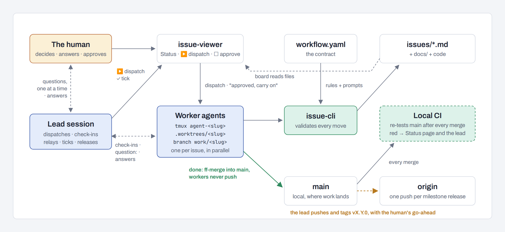
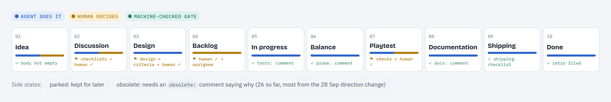
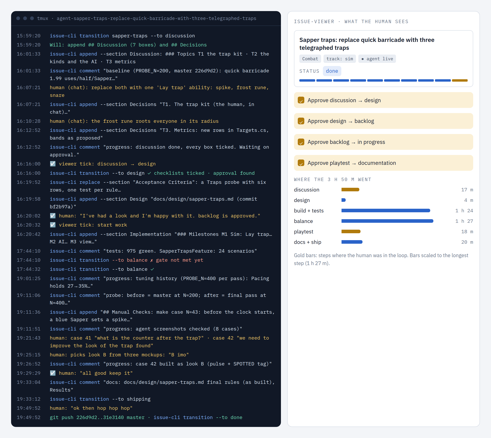

A way to run several agents on one project without the human talking to each of them. The tool knows about **lead agents**: it spawns them, names them, routes workers to them and shows them on the agents canvas. Raid League, a game built this way, is the worked example at the end.

## The roles

| Role | tmux name | Runs in | Does |
|---|---|---|---|
| **The human** | (you) | | Decides. Raises ideas, answers questions, approves gates, playtests. |
| **Project lead** | `lead-<project>` | the project checkout | Runs the project with you: grooms ideas, gets workers dispatched, checks on them, relays their questions, reviews designs and diffs, ticks the gates you approved in its chat, fixes the process from the retros. One per project. |
| **Workers** | `agent-<slug>` | `.worktrees/<slug>` | Own one issue each. Walk it step by step, leave a trail of comments, stop at every human gate. Never tick a gate. |

```
human
  └─ project lead            lead-<project>      project checkout
       ├─ worker             agent-<slug>        .worktrees/<slug>, branched from main
       └─ worker             agent-<child-slug>  epic children too
```

There is one lead per project, and it leads the epics itself (workbench epic D-13). You talk to the lead, and the lead talks to the workers. You can still attach to any session's tmux. The board stays the source of truth for status and approvals.



The name is the identity, the same rule as `agent-<slug>` for workers. Dots and spaces in the project slug become `-`. The lead's session also exports `ISSUE_VIEWER_LEAD_SCOPE=project`, so `issue-cli lead whoami` and the refusals below know who is asking.

## Spawning the lead

Start it with `issue-cli lead spawn`, or **Spawn lead** in the sidebar's Actions or on the [agents canvas](../UI/overview.md). The CLI and the buttons start the same session; the CLI doesn't need the viewer running.

- `lead spawn` starts `lead-<project>` in the project checkout, or a `lead-<project>` window in the shared session when `tmux_session` is set. It runs headless unless you pass `--attach`, which opens a terminal with the same `terminal`/`i3_workspace` settings as dispatch. `--agent codex` runs Codex instead of Claude.
- A lead that is already live is re-attached and its name printed. A second lead is never started.
- A worker can't spawn the lead: it is told to post a `question:` comment, which its lead reads.

### What is an epic

An epic is an issue that other issues name as their parent, or that has `type: epic`. A child links to it with `parent: <epic-slug>`. The older `umbrella: <slug>` is read as an alias; `show` and `start` print a hint to rename it:

```bash
issue-cli set-meta <child-slug> --key parent --value <epic-slug>
```

### Brief

The lead starts with the brief in `leads.project` of `workflow.yaml`. A workflow without it gets a built-in default, so every project has a lead without editing anything.

```yaml
leads:
  project: |
    You are the project lead of {{project}}. You run in {{lead}}. ...
```

Placeholders: `{{project}}` and `{{lead}}`. `issue-cli` commands in the brief get `--project` injected, as in dispatch prompts. The CLI appends a fixed footer: the lead's role, what it may tick, its handoff note, and `issue-cli lead whoami`. An old `leads.epic` key still loads, does nothing, and `issue-cli process workflow` warns about it.

## Routing: who is my lead

Every worker reports to the project lead, epic children included. Whether the lead is live comes from the tmux sessions; nothing is stored.

The worker's dispatch prompt names its lead and its epic under `## Your lead`. `issue-cli show` and `start` print the issue's lead, for example `Lead: lead-<project> (live)`.

## Seeing and reaching leads

| Command | Shows or does |
|---|---|
| `issue-cli lead whoami` | Your role (project lead, worker or unmanaged), the branch you guard, your lead and whether it is live, how to reach it, and what you may tick |
| `issue-cli lead list` | The project lead, live or not, then the open epics with their children running of total |
| `issue-cli lead message <target> "text"` | Pastes the text into a session, signed `[from lead-x]`. Target: `project`, a `lead-`/`agent-` name, or an issue slug (its worker) |
| `/p/<project>/agents` | The agents canvas: the whole tree, each agent's state and the unfinished jobs. Click an agent to open its tmux session; its panel has Approve gate, Spawn and Copy attach (Copy switch with `terminal: none`) |

Agents can also message each other with Claude Code's built-in messaging between sessions (`ListAgents` / `SendMessage`): Claude agents are launched with `-n <tmux name>`, so `lead-<project>` and `agent-<slug>` are their addresses, and the briefs tell workers they may message their lead or a peer this way. Nothing in the tool gates or records these messages. `lead message` is the tmux-paste fallback (for Codex), and workers can't use it; they post `question:` comments, which their lead reads from the issue trail. A lead still reads everything without interrupting anyone:

| Channel | Command | Shows |
|---|---|---|
| Issue | `issue-cli context <slug>` | Status, checklists, comments |
| Branch | `git worktree list`, `git log --oneline main..<branch>` | Code written so far, overlaps between branches |
| Logs | `.agent-logs/<session>/` | Every `issue-cli` call, the full transcript |
| Screen | `tmux capture-pane -p -t <session> \| tail -40` | What the agent is doing or waiting on |

A lead started by hand (plain `claude` in the project root) still works, but the tool can't see it: `lead whoami` reports it as unmanaged and tells it to run `issue-cli lead spawn`.

## Authority: who may tick a gate

Approvals are the `human_approval` field in the issue's frontmatter. The human sets it with the board's checkbox. A lead records an approval you gave in chat with:

```bash
issue-cli approve <slug> --to <status> --quote "<the human's words>" [--how "on a call"]
```

It writes an `approval:` comment with your words, then sets `human_approval`. It never toggles an existing approval off.

| Who | May tick |
|---|---|
| Project lead | Any gate you approved in its chat (`--how` defaults to `in the lead chat`). |
| Worker | Never. |
| Any agent | Never Human Testing; you approve that in the viewer. |

These checks read the environment and the session name. They are guardrails for agents, not security.

## Running it

### Check-ins and stand-ups

While workers run, the lead checks in on a schedule (Raid League uses :07, :27 and :47 past the hour) and reports only what changed: questions waiting, a gate reached, red tests, an idle agent, two branches touching the same files. On request it gives a **stand-up**: one line per dispatched issue with status, last progress and blockers, then the approvals waiting for you.

### Relaying questions

Workers that need a decision ask in chat: they message the lead (Claude Code's SendMessage, addressed by tmux name) with the options and their recommendation, say they're waiting, and stop. The lead brings questions to you **one at a time**, with the worker's recommendation and its own. It records your answer in your words with `issue-cli decide <slug> --text "…" --how "lead chat" --quote "…"`, which writes the `D-n` line under `## Decisions`, then messages the asker.

### Worker rules

The dispatch prompt and the status prompts in `workflow.yaml` already tell workers these, but a short doc your `CLAUDE.md` points to helps sessions that weren't dispatched:

- Own your issue only. New ideas become `idea` issues (`issue-cli create`), referenced with `#slug`.
- Stop at human gates. Ask once in chat, then stop and end your turn; don't wait or poll. Continue when the human messages you that it is approved. A "go" in your chat is not an approval.
- Leave a trail: tick boxes as they're done, add `progress:` comments at milestones, and the comments your gates require (`tests:`, `docs:`, …).
- Commit on your own branch as you go; only shipping merges.
- Write a retrospective when you stop (`issue-cli retrospective`).

### Before dispatching

- Commit process changes (`CLAUDE.md`, `workflow.yaml`) first: worktrees branch from the checkout's `HEAD`, so workers read whatever is committed there.
- Don't dispatch onto a pending gate. If `issue-cli checklist <slug>` shows the issue only waits for your approval, ask for it instead; a worker would claim the issue and stop.

### Handoff and restarts

The lead writes a handoff note before it exits: `sessions/YYYY-MM-DD-lead-<project>.md`. The note ends with a `## Next` section: the ordered next steps. The viewer's Status page (`/p/<project>/status`) shows that `## Next` list, and its text form, `/p/<project>/status.md`, is a ready-made stand-up to paste. A new lead's brief names its newest note to read first, falling back to the older `sessions/*-lead-session.md`.

After a restart (tmux and the board gone, worktrees kept):

1. Start the board and run `issue-cli lead spawn`.
2. The lead reads its note.
3. The canvas's **Unfinished jobs** lane lists the issues with a worktree or an active status and no live agent. Re-dispatch those from the board; it reuses their worktrees.

## Epics

A large feature built in many pieces runs as an **epic** with **child issues**. The project lead leads it. Each child is an ordinary issue: it branches from `main` and ships to `main`.

1. Link each child to the epic: `issue-cli set-meta <child> --key parent --value <epic>`.
2. Dispatch the children from the board, in the order the epic's design gives.
3. The epic issue runs the workflow too: its build boxes tick when every child has shipped.

An epic may still carry `base:` or `lead:` from when each epic had its own branch and lead. Both are read as plain custom fields and change nothing.

The [issues canvas](../UI/overview.md#issues-canvas) shows epics with their children and roll-up progress per version. To show the human an epic's state, send `/p/<project>/canvas?hl=<epic slug>`.

## Worked example: Raid League

Raid League is a football-manager-style game about a fantasy siege tourney, built in Godot and C# by one person and Claude agents since September 2026. It ran this pattern on one board project, starting as a convention before leads were part of the tool:

- **235 issues**, a **710-line `workflow.yaml`** with ten statuses and 13 system overlays, and three board buttons (*Balance report*, *Speed sweep*, *Idea sweep*).
- **Four human gates**: discussion → design, design → backlog, starting work, and playtest → documentation. The lead may tick discussion → design once every question was answered by the human and recorded, and any gate the human approves in its chat, always after an `approval:` comment.
- **Workers** run as windows in one shared tmux session for the project, each in a worktree under `.worktrees/` with `issues/` left out.
- **Retros** from every worker are swept by the lead, which fixes the process and files tool issues; swept files move to `retros/archive/`.
- **An epic** (a new game mode) staged around 18 child issues on its own experiment branch, before the tool settled on one lead and children shipping to `main`.



One issue there, replayed from its logs, went from discussion to pushed in 3 h 50 m with four approvals and a few chat answers:


