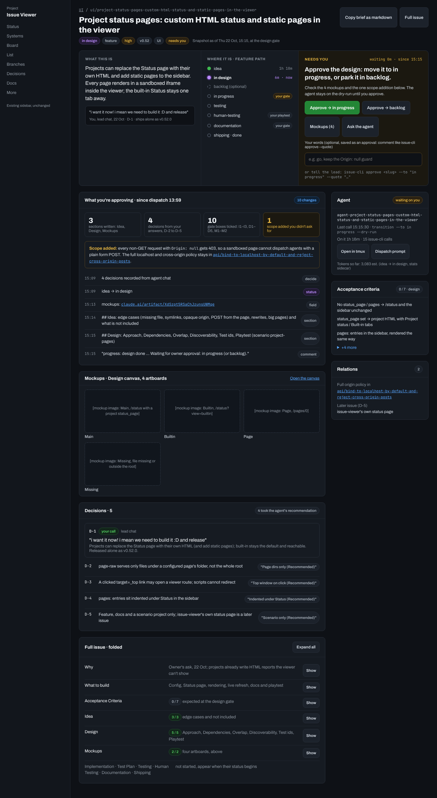
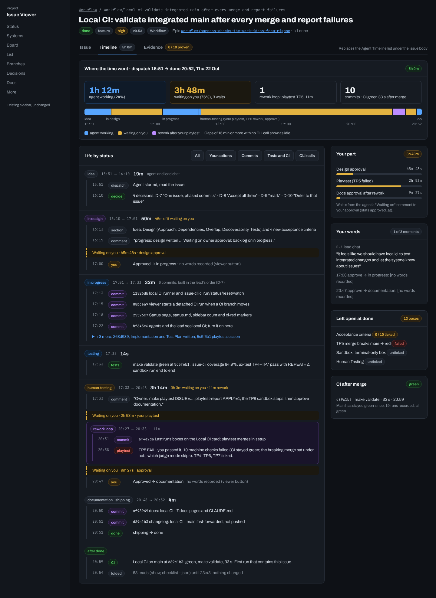
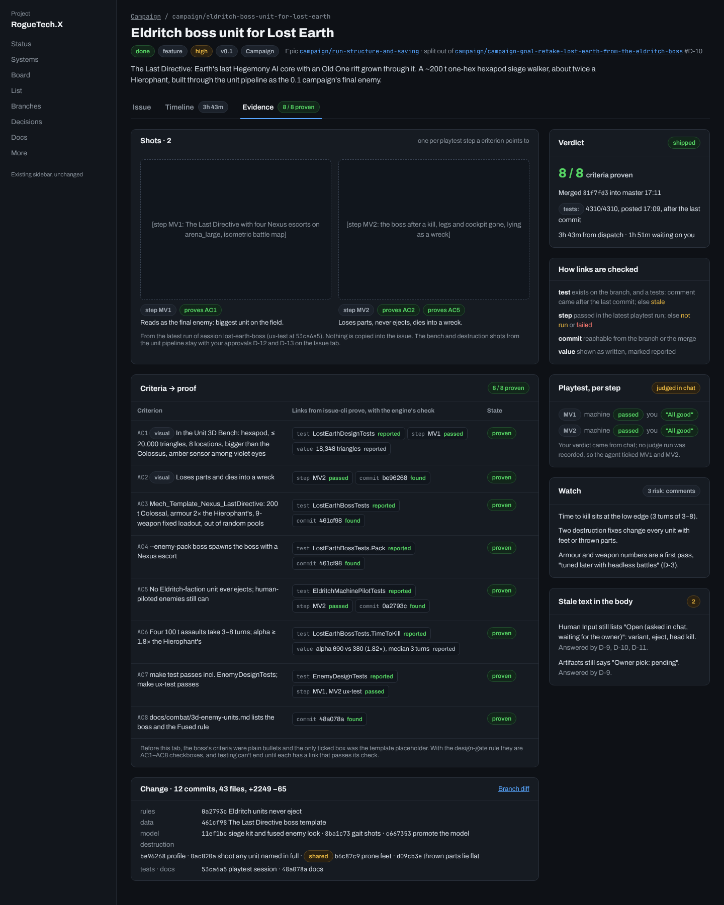
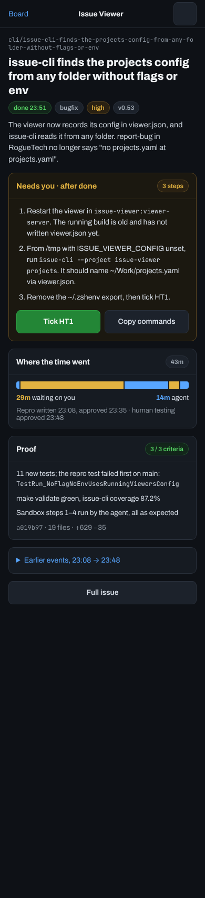
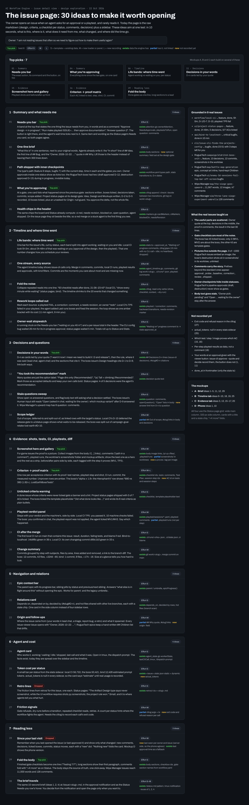

The owner opens an issue when an agent asks for an approval or a playtest, and rarely reads it. Today the page is
the raw markdown plus a sidebar, with the Agent Timeline (issue-cli calls only) under the body. Owner, 2026-10-22:
"i am not reading issues that often so we need to figure out how to make them useful again".

The page becomes three tabs:

1. **Issue** — the Needs-you bar, a one-line brief, what you're approving since the last gate, decisions in your
   words, and the body folded. Mockup board A, minus "From the agent's retro" and "Since your last visit" (dropped).
2. **Timeline** — where the time went (agent working vs waiting on you, per status), the issue's life by status with
   commits, decisions, comments, tests and CI inline. It replaces today's Agent Timeline. Mockup board B.
3. **Evidence** — screenshots tagged with what they prove, the verdict, criteria → proof, change summary, playtest
   verdict, stale body text, what to watch. Mockup board C.

The phone view (board D) is the Issue tab at 390 px.

## What the data analysis found

`analysis` checks every element of the three tabs against the code at v0.52.0. 24 of 33 elements work from data
recorded today: the clilog (every issue-cli call with full args), telemetry (exit code, error class), the stats
sidecar, comments, decisions, git and playtest `results.yaml`. The rest:

| Bucket | Elements | Child |
|:--|:--|:--|
| issue-cli records more, no new ask | gate refusals, CI after merge | `cli/clilog-and-stats-record-what-the-timeline-needs` |
| Viewer change | your words at an approval | `ui/approve-button-takes-your-words` |
| New agent ask | criterion → proof, proof shots, image tags, watch list | `workflow/issue-cli-prove-link-each-criterion-to-its-proof` |

## Children

| Child | Size | What it covers |
|:--|:--|:--|
| `ui/timeline-tab-replaces-the-agent-timeline` | M | The tab bar, and the Timeline tab from today's data, with a "CLI calls" filter so nothing in the old list is lost |
| `cli/clilog-and-stats-record-what-the-timeline-needs` | S | Exit code in the clilog, `waiting_since`, branch head and merge sha, comment timestamps, `dispatched_at` |
| `ui/approve-button-takes-your-words` | S | Optional words on the viewer's approve button, saved like `issue-cli approve --quote` |
| `ui/issue-tab-brief-needs-you-bar-and-a-folded-body` | M | Needs-you bar, brief, what you're approving, decisions, folded body, agent card, relations; phone layout |
| `workflow/issue-cli-prove-link-each-criterion-to-its-proof` | M | `issue-cli prove` links each criterion to a test, playtest step or commit and the engine checks the link; no copied screenshots; criteria with ids, `risk:` comments |
| `ui/evidence-tab-proof-shots-and-criteria` | M | The Evidence tab on top of `prove` and `results.yaml` |

## Overlap with 0.54 Project health

The roadmap's 0.54 milestone lists "workflow timeline (working, waiting on owner, idle)" under
`workflow/project-health-trends-that-tell-the-owner-when-the-project-gets-slower`. The Timeline tab is the per-issue
view of the same data. Build the recording once (`cli/clilog-and-stats-…`) and let Project health aggregate it.

Dropped on 2026-10-22: an agent heartbeat (the raw log is being removed; the agent-vs-you split comes from gates and
approvals, and gaps of 15 min or more with no CLI call show as idle) and tokens by step.

0.54's rule is "agents don't self-report". `workflow/issue-cli-prove-link-each-criterion-to-its-proof` asks agents
where the proof is, and the engine checks each link (test passed, step passed, commit reachable), so the claim is
verified rather than trusted.

## Order

1. Timeline tab from today's data, and the clilog/stats recording. They ship together; the old Agent Timeline goes.
2. Approve button words.
3. Issue tab.
4. `prove`, then the Evidence tab.

## Mockups

The canvas (`mockups`) and the data analysis (`analysis`) are private Claude artifacts. Their sources are saved in
`issues/attachments/issue-page-tabs-issue-timeline-evidence/`: the `.dc.html` artboards with `canvas.json`, a PNG of
each (`tools/mockup-shots/shots.py`), and the analysis as
[data-analysis.md](../attachments/issue-page-tabs-issue-timeline-evidence/data-analysis.md).

### Issue tab (board A)

`ui/project-status-pages` at its design gate. A top band in three columns: what this is (one sentence and the owner's
quote with its D-n), where it is (the type's path with time per status and the gates the owner holds), and Needs you
(the action in words, Approve → in progress / → backlog, Mockups, Ask the agent, an optional words box, and the
`issue-cli approve` line for the lead). Below: What you're approving since dispatch (counts of sections, decisions,
boxes and unasked scope, then the clilog events in order), mockup thumbnails, decisions led by the owner's quote with
"took the recommendation" marks, and the full issue folded per section with its box counts. Side column: agent card,
acceptance criteria, relations. The two cards "From the agent's retro" and "Since your last visit" were dropped. The
tab bar is not drawn on this board yet; the agent card's token line is a leftover.

### Timeline tab (board B)

`workflow/local-ci`, done. Tab bar Issue · Timeline (5h 0m) · Evidence (0 / 10 proven, amber). Where the time went:
four counters (agent working, waiting on you, rework loops, commits) and one bar cut by status, coloured agent /
waiting on you / rework, with times under it; gaps of 15 min or more with no CLI call count as idle. Life by status:
one band per status with its span and duration, events inside it (dispatch, decide, section, comment, commit, tests,
playtest, you), amber "Waiting on you · 45m 48s · design approval" rows, a purple rework-loop box, and repeated reads
folded into one line. Filters: All, Your actions, Commits, Tests and CI, CLI calls (today's Agent Timeline with the
workflow actions each transition saw). Side column: your part (each wait as a bar), your words at each approval or
"no words recorded", what was left open at done, CI after merge.

### Evidence tab (board C)

RogueTech's Eldritch boss, done. Tab label "8 / 8 proven". Shots: one per playtest step a criterion points to (MV1,
MV2), from the latest playtest run, each tagged with the criteria it proves; nothing copied into the issue. Verdict
(proven count, merge, the `tests:` result and that it came after the last commit, time and wait) and a key to how each
link kind is checked. Criteria → proof: AC1–AC8 with a visual marker where it applies, each `prove` link (test, step,
commit, value) with the engine's check result, and a state. Change summary by area. Side column: playtest per step
(machine result and the owner's verdict), Watch from `risk:` comments, stale text in the body.

### Phone (board D)

The Issue tab at 390 px for an issue done with steps left for the owner: Needs you with numbered steps and Tick HT1 /
Copy commands, where the time went, proof, earlier events folded, Full issue.

### Ideas board

The 30 ideas behind the tabs, grouped, with effort, data status and top picks; ideas 26 (retro lines) and 28 (since
your last visit) are marked dropped.
